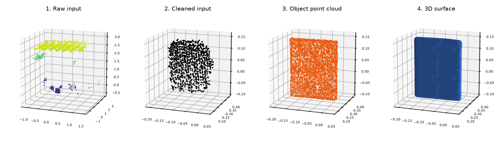
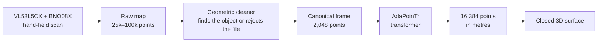
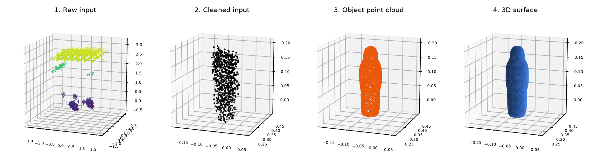
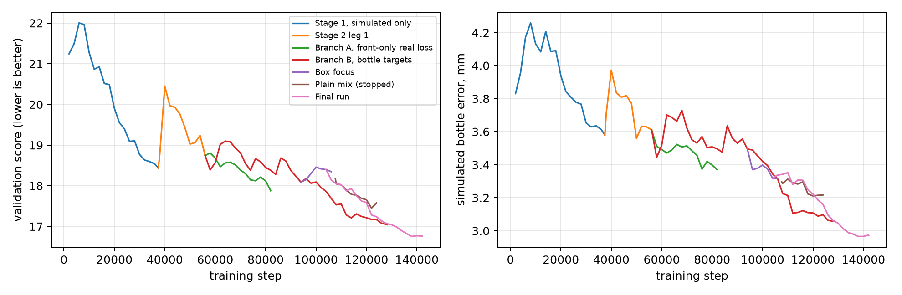

<div align="center">

# DeepSonar 3D

**See the whole object from one side.**

One hand-held scan from an 8×8 time-of-flight sensor goes in. A complete 3D object, in real metres, comes out, and the AI runs entirely on your own device.

[](https://github.com/aryanipb/deepsonar-3d/actions/workflows/ci.yml)
[](https://github.com/aryanipb/deepsonar-3d/actions/workflows/release.yml)
[](https://github.com/aryanipb/deepsonar-3d/releases/latest)
[](https://aryanipb.github.io/deepsonar-3d/)

**[Try the live demo](https://aryanipb.github.io/deepsonar-3d/)** · **[Download the Android app](https://github.com/aryanipb/deepsonar-3d/releases/latest)** · **[Read the 23-page report](docs/DeepSonar_Project_Report.pdf)** · **[Model card](MODEL_CARD.md)**



<sub>A real scan held out of all training: the raw room map, the cleaned visible face, the predicted object and its 3D surface.</sub>

</div>

## At a glance

| | |
|---|---|
| **Input** | One raw file from a hand-held VL53L5CX (8×8 zones) and BNO08X IMU. No label, no template, no size hint |
| **Output** | 16,384 points and a closed 3D surface, in metres |
| **Runs on** | The CPU of a browser, Android phone or Linux PC. Nothing is uploaded |
| **Model** | AdaPoinTr transformer, fine-tuned for 142,129 steps; 139 MB ONNX |
| **Held-out real scans** | **3.1 mm** (box) and **4.8 mm** (bottle) from a reference shape of the known object |
| **Simulated test** | Median error **2.7–3.8 mm** on round objects, against 9.1–22.4 mm for the official pretrained weights |
| **Accuracy gates** | **10 of 18 pass.** Fixed before any result was seen; [all 18 are below](#pre-registered-gates-10-of-18-pass) |
| **Export check** | ONNX matches PyTorch on all 23 probes |

> **What this result does and doesn't show.** The sensor sees one side only, so width and height are measured but the back and depth are predicted. The back of a real object was never measured. The real-scan results cover one box and one bottle, in one room, on one device, and both objects also appear in training sessions, so they show the model works on these two objects. Generalising to new objects is not proven: both generalisation probes fail. See [Known limits](#known-limits).

## Why this is hard

An 8×8 sensor returns at most 64 distances per frame, and only 17–24 of them land on the object. The hand-held motion is never tracked, so the object smears by about 5 cm in depth. Each file also holds the whole session: ceiling, table, furniture and swing streaks. The pipeline has to find the object in that map, then predict the side nobody measured.

## How it works



1. **Cleaner** (`majproj/clean.py`): pure geometry, with no learned parts. It picks the surface the user dwelled on, keeps one surface through the hand drift, and rejects the file with a reason if the answer is ambiguous.
2. **Canonical frame** (`majproj/canon.py`): aligns the view and scales from the seen points only, so the frame gives away nothing about the object's kind.
3. **Completion model** (`majproj/model/`): AdaPoinTr (Yu et al., *IEEE TPAMI 2023*), fine-tuned from the official PCN weights. The network receives points and nothing else.
4. **Deployment** (`webapp/`): the Python pipeline ported to JavaScript and run through ONNX Runtime Web, with one web app powering all three targets. Android uses Capacitor and Linux uses Electron.



<sub>The same four stages on a held-out bottle scan.</sub>

## Results

### Pre-registered gates: 10 of 18 pass

All thresholds were written down before the first result and weren't changed afterwards. Failures stay in the table.

| Gate | Result | Detail |
|---|---|---|
| Sim: median CD below returning the input, every kind | ✅ PASS | No failing kinds |
| Sim: median CD below official PCN weights, every kind | ✅ PASS | No failing kinds |
| Sim: median CD at most 5.0 mm, every kind | ❌ FAIL | cuboid, cube, slab, tower |
| Sim: mean F@10 mm at least 0.8, every kind | ❌ FAIL | cuboid, cube |
| Real: all 20 sessions give an output | ✅ PASS | None rejected |
| Real: one-sided median at most 10.0 mm | ❌ FAIL | 2 sessions: 122622, 123146 |
| Bottle: section residual / radius at most 0.1 | ❌ FAIL | 2 sessions: 123028, 123523 |
| Bottle: angular coverage at least 0.9 | ❌ FAIL | 2 sessions: 123028, 123523 |
| Bottle: section aspect at least 0.8 | ❌ FAIL | 2 sessions: 123028, 123523 |
| Box: median face flatness at most 5.0 mm | ✅ PASS | All sessions |
| Box: worst right-angle error at most 5.0° | ✅ PASS | All sessions |
| Box: at least 0.8 of output within 8 mm of a fitted face | ✅ PASS | All sessions |
| Box: width std/mean across sessions at most 0.1 | ✅ PASS | 0.018 over 11 sessions |
| Box: height std/mean across sessions at most 0.1 | ✅ PASS | 0.010 over 11 sessions |
| Bottle: width std/mean across sessions at most 0.1 | ✅ PASS | 0.099 over 9 sessions |
| Bottle: height std/mean across sessions at most 0.1 | ✅ PASS | 0.024 over 9 sessions |
| Probes: plate, rod, cube, noise differ, margin at least 3.0 | ❌ FAIL | Margin 0.92 |
| Probe: output follows a halved width, ratio at most 0.75 | ❌ FAIL | Ratio 0.882 (0.5 tracks fully, 1 is a fixed shape) |

Full report: [`docs/evidence/evaluation.md`](docs/evidence/evaluation.md).

### Simulated test set

1,857 unseen simulated scans of new objects; validation chose the checkpoint and is not used here. This table covers the 1,637 room-faithful scans where the cleaner kept the object. CD is Chamfer L1 at true scale, and lower is better. The cleaner rejected 9.3 % of drawn test scans, and those aren't counted.

| Kind | Scans | Median CD (mm) | Official PCN (mm) | Input alone (mm) | F@10 mm | Unseen recall@10 mm | Width err (mm) | Height err (mm) | Depth err (mm) |
|---|---:|---:|---:|---:|---:|---:|---:|---:|---:|
| Cuboid | 296 | **6.5** | 30.9 | 31.7 | 0.782 | 0.651 | 19.3 | 4.7 | 62.4 |
| Cube | 97 | **5.7** | 50.9 | 47.3 | 0.789 | 0.685 | 21.9 | 3.7 | 33.6 |
| Slab | 77 | **6.8** | 14.4 | 14.1 | 0.830 | 0.723 | 15.6 | 4.2 | 70.7 |
| Tower | 102 | **5.3** | 15.2 | 17.8 | 0.907 | 0.837 | 6.3 | 6.5 | 30.9 |
| Bottle | 371 | **2.9** | 13.6 | 15.8 | 0.991 | 0.996 | 3.2 | 5.1 | 3.3 |
| Wavy bottle | 220 | **2.9** | 13.4 | 15.5 | 0.990 | 0.996 | 3.8 | 4.1 | 3.7 |
| Can | 124 | **2.7** | 17.4 | 18.4 | 0.985 | 0.991 | 4.4 | 3.7 | 4.6 |
| Jar | 129 | **3.1** | 22.4 | 22.8 | 0.979 | 0.983 | 5.2 | 3.1 | 5.2 |
| Rod | 100 | **3.2** | 9.1 | 11.4 | 0.984 | 0.994 | 4.3 | 9.7 | 6.2 |
| Pipe | 121 | **3.8** | 19.1 | 22.0 | 0.961 | 0.947 | 5.0 | 8.4 | 4.9 |

Round objects have small depth errors because the seen width implies the depth. One face of a box doesn't reveal its depth, so the network hedges: that's the 30–71 mm depth error above.

Across **every** accepted scan (1,857), the median CD is 3.7 mm in the room-faithful regime (1,711 scans) and 8.1 mm in invented rooms (146 scans). Mean CD is much higher, at 20.7 mm and 45.4 mm, because a wrong pick by the cleaner gives a confidently wrong shape. Median CD also jumps to 9.4 mm beyond 0.40 m.

### Real scans

20 sessions, 2 of them held out of every training stage.

| Held-out session | Distance from reference shape | Output size, W × H × D (cm) | Seen points to output, median |
|---|---:|---:|---:|
| Box (121600) | **3.1 mm** | 18.9 × 24.3 × 6.8 | 5.7 mm |
| Bottle (123815) | **4.8 mm** | 6.9 × 22.6 × 6.9 | 8.5 mm |

The reference shape is a parametric model of the known object, registered to the front of each scan. It isn't a 3D scan of the real thing. The box reference uses 18.8 × 23.4 cm from the sensor data and an **assumed** 2 cm depth, and the bottle reference is an outline taken from a photo. Neither object has been measured with a ruler yet. The output depth of the box (6.8 cm) therefore shouldn't be read as correct.

Repeatability across all sessions of the same object:

| Object | Sessions | Width (cm) | Height (cm) | Depth, never measured (cm) | Pairwise output distance, median |
|---|---:|---:|---:|---:|---:|
| Box | 11 | 18.4 ± 0.3 | 23.5 ± 0.2 | 6.8 ± 1.0 | 3.2 mm |
| Bottle | 9 | 6.8 ± 0.7 | 23.0 ± 0.6 | 7.4 ± 0.6 | 2.8 mm |

Per-session figures: [`docs/metrics/real_sessions.csv`](docs/metrics/real_sessions.csv). Filter on `run` = `final7`.

## Training

Training took **15.8 GPU-hours on one NVIDIA H100** across seven runs, including parallel branches. Simulated validation picked the weights inside each run; choices between branches also looked at the two held-out sessions.

| Item | Value |
|---|---|
| Starting weights | Official AdaPoinTr-PCN |
| Simulated data | 61,137 train, 3,675 validation, 1,857 test |
| Real data | 18 sessions in training, 2 held out |
| Steps | 142,129, or about 37 passes over the simulated training scans |
| Selected weights | Step 138,000 (EMA), best validation score: 16.755 |
| Batch | 16 simulated, plus 8 real from stage 2 at loss weight 3 |
| Optimiser | Learning rate 1e-4, then 5e-5; weight decay 5e-4; 500 warm-up steps; cosine schedule |
| Precision | float16 autocast, gradient clip 10 |
| Loss | Sparse and dense Chamfer L1 with AdaPoinTr's denoising term |



| Run | Steps | From → to | Passes | Hours | What changed |
|---|---:|---:|---:|---:|---|
| `final1` | 37,400 | 0 → 37,400 | 9.8 | 2.4 | Stage 1: simulated scans only |
| `final2` | 20,354 | 37,446 → 57,800 | 5.3 | 1.3 | Real scans enter every batch; interrupted, resumed from step 56,000 |
| `final3` | 28,000 | 56,000 → 84,000 | 7.3 | 1.8 | Branch A: real scans score the front only |
| `final4` | 72,200 | 56,000 → 128,200 | 18.9 | 4.9 | Branch B: full bottle reference shapes |
| `final5` | 13,600 | 94,000 → 107,600 | 3.6 | 1.1 | Box focus with full box references |
| `final6` | 17,861 | 107,639 → 125,500 | 4.7 | 1.3 | Plain mix; stopped early |
| `final7` | 38,100 | 104,000 → 142,100 | 10.0 | 3.0 | **Final run**: plain mix of simulated and real scans |

Passes are counted on simulated training scans of 16 per step. Raw logs: [`docs/metrics/`](docs/metrics/) and [`docs/evidence/final_final7.jsonl`](docs/evidence/final_final7.jsonl).

## Engineering quality

- **Pre-registered gates:** targets are fixed before results, and failures are published.
- **Leave-session-out evaluation:** sessions `121600` and `123815` never enter training or the simulator's room bank.
- **Device-faithful simulation:** room frames from real sessions, with new objects ray-cast through the VL53L5CX model.
- **Verified export:** the ONNX model matches PyTorch on all 23 probes, 22 of them to below 1e-5 Chamfer ([log](docs/evidence/onnx_parity_final7.log)).
- **Reproducible runs:** code, config and dataset hashes are recorded with every run.
- **CI/CD:** GitHub Actions runs the tests on each push, deploys the live demo, and builds the signed APK and AppImage for each tagged release.

## Run it

**In a browser:** open the [live demo](https://aryanipb.github.io/deepsonar-3d/) and pick a sample scan. The first visit downloads the 139 MB model.

**Locally:**

```bash
git clone https://github.com/aryanipb/deepsonar-3d.git
cd deepsonar-3d
python3 -m http.server 8000 --directory webapp
# open http://localhost:8000
```

**From Python:** download `adapointr_final.pth` from the [latest release](https://github.com/aryanipb/deepsonar-3d/releases/latest) into `checkpoints/`, then:

```bash
uv sync --group dev
uv run python -m majproj.infer FINAL-INPUTS/BOX/scan_20261030_121600.npy --ckpt checkpoints/adapointr_final.pth
```

**Tests:**

```bash
PYTHONPATH=. uv run --with pytest python -m pytest tests -q
node webapp/test/surface.test.mjs
```

The clone is about 200 MB because the model and raw scans are in the repo.

## Repository map

| Path | Contents |
|---|---|
| `majproj/` | Cleaner, canonical frame, simulator, training, inference, model |
| `scripts/` | Dataset generation, evaluation, ONNX export, packaging |
| `configs/` | Training config, simulator calibration, real-room bank |
| `tests/` | Python test suite |
| `webapp/` | The app: JavaScript pipeline, ONNX model, sample scans |
| `web/` `linux/` | Android (Capacitor) and Linux (Electron) packaging |
| `FINAL-INPUTS/` | 27 raw files from the 20 real sessions |
| `inputs/` `inputs_box/` | Older normalised exports, used by the regression tests |
| `docs/` | Report, evaluation evidence, metrics and figures |

## Known limits

- **Two real objects only:** one box and one bottle, in one room, on one device. Results are specific to them.
- **Pull toward learned shapes:** with a halved input width, the output's width/height ratio changes by a factor of only 0.88 (0.5 would be full tracking), so new objects may be drawn toward known ones.
- **Unmeasured depth:** one face can't reveal a box's depth, and the box reference depth is assumed.
- **Two weak bottle sessions:** `123028` and `123523` fail all three roundness gates, with output widths of 6.8 and 5.0 cm.
- **Upright objects only:** the cleaner treats anything lying flat as a table or shelf.
- **Best under 0.40 m:** quality drops sharply beyond that, and the invented-room regime is far harder.
- **Limited leave-out:** only two sessions are held out of training. They also guided choices between training branches, and the cleaner's thresholds were tuned with every session in view, so they aren't a pure test set.

## Roadmap

1. Measure both objects with a ruler and replace the assumed reference dimensions.
2. Scan many new objects in new rooms, with true leave-object-out evaluation.
3. Close the generalisation gap, so the two failing probe gates pass.
4. Add live capture, so the app scans directly from the sensor.

## Credits

Built by **[Aryan Babar](https://github.com/aryanipb)**.

Built on [AdaPoinTr / PoinTr](https://github.com/yuxumin/PoinTr) (MIT), [ONNX Runtime Web](https://onnxruntime.ai/), [Plotly.js](https://plotly.com/javascript/) and [Capacitor](https://capacitorjs.com/). Sensor geometry follows the MIT-licensed VL53L5CX-BNO08X viewer by Henrique Ferrolho and ST's per-zone angle tables.

Copyright © 2026 Aryan Babar. All rights reserved; see [LICENSE](LICENSE). Third-party components keep their own licences.
